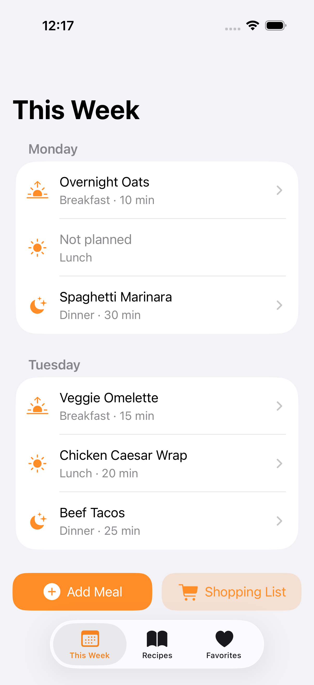
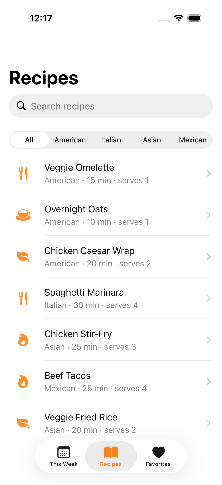
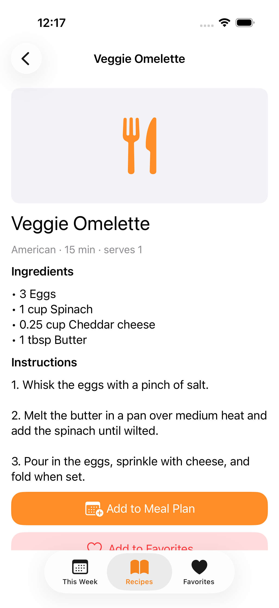
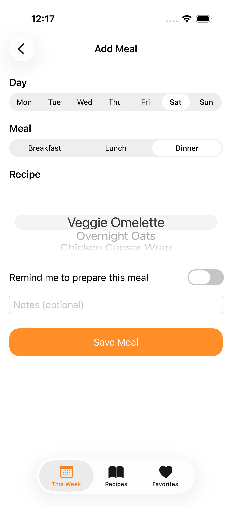
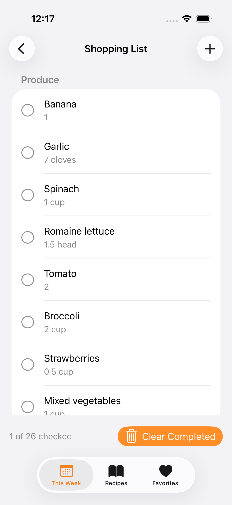
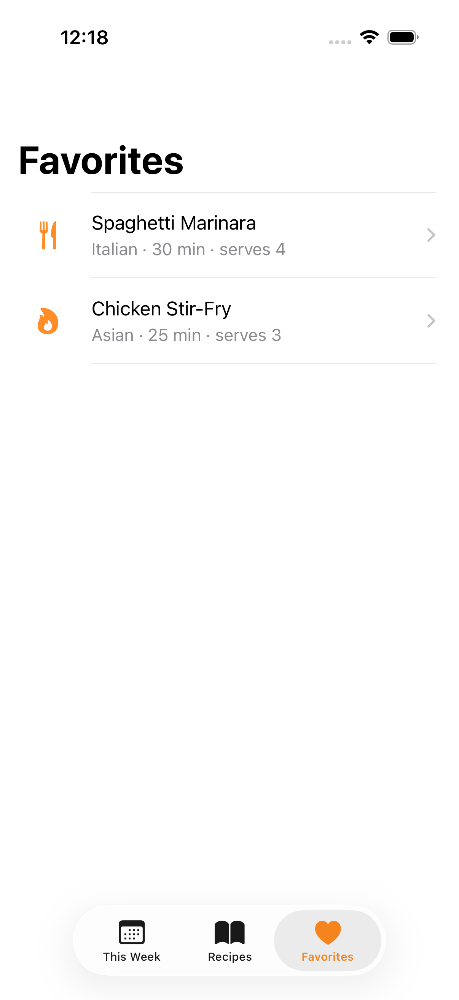

# Weekly Meal Planner

**CPSC 411 – Final Project, Milestone 1: UIKit User Interface**
**Student:** Maxwell Tan

[](https://github.com/max-tan/WeeklyMealPlanner/actions/workflows/ios.yml)

## Project Description

Weekly Meal Planner helps busy students and professionals decide what to eat for the week and what to buy for it. Users browse a set of recipes, assign them to breakfast, lunch, or dinner on any day, and see the week laid out at a glance. The app then builds a shopping list from the planned meals, merges duplicate ingredients, and groups items by category so the list is easy to use in the store. It solves the daily "what should I cook?" problem and cuts down on forgotten ingredients and wasted food. A mobile app fits because the plan and the list are needed at the grocery store, can be adjusted during the week, and can later send reminders to prepare meals or shop.

This milestone implements the interface in programmatic UIKit with hard-coded sample data. Persistence, camera, and notifications are planned for the final milestone.

## Screen List

| # | Screen | Class | Purpose |
|---|--------|-------|---------|
| 1 | Home / Weekly Plan | `WeeklyPlanViewController` | Shows all 7 days with breakfast, lunch, and dinner slots. Buttons to add a meal and open the shopping list. |
| 2 | Recipe List | `RecipeListViewController` | Browse recipes, search by name or cuisine, filter by cuisine with a segmented control. |
| 3 | Recipe Detail | `RecipeDetailViewController` | Image, info, ingredients, and instructions, with Add to Meal Plan and Add/Remove Favorite buttons. |
| 4 | Add Meal (Add/Edit) | `AddMealViewController` | Form to pick day, meal, and recipe, set a reminder switch, and add notes. |
| 5 | Shopping List | `ShoppingListViewController` | Items grouped by category, tap to check off, add custom items, swipe to delete, Clear Completed. |
| 6 | Favorites | `FavoritesViewController` | Saved recipes. Tap for details, swipe right to plan, swipe left to remove. |

## Screen Navigation Diagram

```
UITabBarController
 |
 +-- Plan tab: Home (Weekly Plan)
 |     +-- tap a planned slot ------------> Recipe Detail
 |     +-- tap an empty slot / Add Meal --> Add Meal
 |     +-- Shopping List button ----------> Shopping List
 |
 +-- Recipes tab: Recipe List
 |     +-- tap a recipe ------------------> Recipe Detail
 |                                            +-- Add to Meal Plan --> Add Meal
 |
 +-- Favorites tab: Favorites
       +-- tap a recipe ------------------> Recipe Detail
       +-- swipe right "Plan" ------------> Add Meal
```

Main workflow: Home -> Recipe List -> Recipe Detail -> Add Meal -> back to Home. Every screen is pushed on a `UINavigationController`, so the back button always works.

## Running the Project

Requires macOS with Xcode 15+. The project is committed and ready to open directly:

```bash
open WeeklyMealPlanner.xcodeproj
```

Then choose an iPhone simulator and press Run.

The `.xcodeproj` and `Generated/Info.plist` are generated from [`project.yml`](project.yml) using [XcodeGen](https://github.com/yonaskolb/XcodeGen) and kept in sync automatically by CI on every push (see below) — if you change `project.yml` yourself, regenerate locally with `brew install xcodegen && xcodegen generate` before committing. `project.yml` is the source of truth; avoid editing the `.xcodeproj` directly, since the next CI sync will overwrite manual changes.

## Continuous Integration

Every push and pull request to `main` runs [`.github/workflows/ios.yml`](.github/workflows/ios.yml) on a macOS GitHub Actions runner:

1. Installs XcodeGen and regenerates the Xcode project from `project.yml`.
2. Builds the app for the iOS Simulator (`CODE_SIGNING_ALLOWED=NO`, no provisioning profile needed) to confirm the project compiles.
3. Boots an available iPhone simulator and runs the `WeeklyMealPlannerUITests` UI test ([`WeeklyMealPlannerUITests/WeeklyMealPlannerUITests.swift`](WeeklyMealPlannerUITests/WeeklyMealPlannerUITests.swift)), which launches the app and walks through all six screens (Weekly Plan, Shopping List, Add Meal, Recipe List, Recipe Detail, Favorites), attaching a screenshot of each.
4. Exports those screenshots from the `.xcresult` bundle ([`scripts/export_screenshots.py`](scripts/export_screenshots.py)) and uploads them as a `simulator-screenshots` workflow artifact.
5. On a push to `main`, commits the regenerated `.xcodeproj` and the fresh screenshots (into [`Screenshots/`](Screenshots)) straight back into the repo (`[skip ci]`, so it doesn't retrigger the workflow) — so the committed project always opens directly and the screenshots below are always current, with no manual step.

## Milestone 1 Requirements Checklist

- **UIKit, programmatic (Option B):** all views are created in code. No storyboards.
- **Four or more screens:** six screens (Home, List, Detail, Add/Edit, plus Shopping List and Favorites).
- **Auto Layout:** constraints against the safe area throughout. No fixed frames.
- **UIStackView:** bottom button bars, the Add Meal form, the Recipe Detail content, and the shopping summary bar.
- **UITableView:** Weekly Plan (sectioned by day), Recipes, Shopping List (sectioned by category), and Favorites. All use `UITableViewDataSource` and `UITableViewDelegate`.
- **Navigation:** `UITabBarController` plus `UINavigationController` with `pushViewController`.
- **Controls:** `UIButton`, `UILabel`, `UITextField`, `UISwitch`, `UISegmentedControl`, `UIImageView`, `UIPickerView`, `UISearchController`.
- **Sample data:** 8 recipes, a pre-filled week, 2 favorites, and a generated shopping list in `DataStore.swift`.

## Screenshots

Captured automatically by CI from the iOS Simulator on every push to `main` (see [Continuous Integration](#continuous-integration)) — these are always up to date with the current code.

| Weekly Plan | Recipe List | Recipe Detail |
|---|---|---|
|  |  |  |

| Add Meal | Shopping List | Favorites |
|---|---|---|
|  |  |  |
